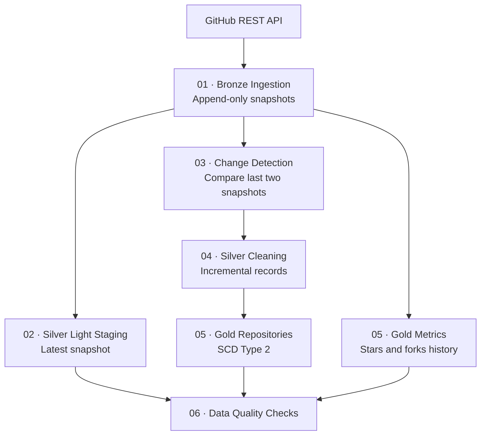

# Open Source Analytics Lakehouse

[](https://www.databricks.com/)
[](https://spark.apache.org/)
[](https://delta.io/)
[](https://developer.hashicorp.com/terraform)
[](https://www.jenkins.io/)

An end-to-end **Data Engineering portfolio project** that ingests public GitHub repository metadata and builds a historical analytics lakehouse on **Databricks, PySpark, Delta Lake and Unity Catalog**.

It demonstrates **Medallion Architecture**, snapshot-based change detection, **Slowly Changing Dimension Type 2 (SCD2)**, automated data quality checks, **Terraform Infrastructure as Code**, **Databricks Asset Bundles**, and a **Jenkins CI/CD pipeline** running inside Docker.

## Architecture



> Tasks run sequentially in the Databricks Job. Change Detection compares the latest two **Bronze** snapshots directly; Gold Metrics also reads Bronze. The diagram emphasizes data dependencies rather than task order.

### Medallion tables

| Layer | Table | Purpose |
|---|---|---|
| Bronze | `bronze_github_repositories` | Append-only API snapshots, raw JSON and ingestion metadata |
| Silver | `silver_staging_github_repositories` | Latest snapshot for an organization |
| Silver | `silver_changes_github_repositories` | New and descriptively updated repositories |
| Silver | `silver_github_repositories` | Cleaned incremental repository records |
| Gold | `gold_github_repositories` | Historical repository dimension using SCD Type 2 |
| Gold | `gold_github_repository_metrics` | Per-snapshot stars/forks metrics and trends |

The source is the [GitHub REST API](https://docs.github.com/en/rest/repos/repos#list-organization-repositories). The default organization is `databricks`, configurable through a Job parameter.

## Change Detection

The workflow selects the latest two Bronze snapshots for an organization and joins repositories by GitHub `id`.

Six descriptive attributes are tracked with null-safe comparison (`eqNullSafe`): `name`, `full_name`, `description`, `language`, `archived` and `default_branch`.

- **`NEW`** — repository absent from the previous snapshot.
- **`UPDATED`** — one or more monitored attributes changed.
- **`UNCHANGED`** — no monitored attribute changed.
- **Initial load** — with no previous snapshot, all repositories are `NEW`.

Only `NEW` and `UPDATED` rows are written to `silver_changes_github_repositories`. Star and fork count changes do **not** generate descriptive updates: those metrics are historized independently.

This is **snapshot-difference detection**, not event-based GitHub CDC. Repository deletion detection is not yet implemented.

## Gold: SCD Type 2 and metric history

The Gold repository dimension preserves descriptive changes using Delta Lake `MERGE`:

- Deterministic surrogate key (`repository_sk`) derived from repository and snapshot identifiers.
- Temporal columns `valid_from`, `valid_to` and `current`.
- Existing active versions close when monitored attributes change, and new active versions are inserted.
- A `merge_id` staging pattern supports closing existing versions and inserting new versions.
- Reprocessing the same descriptive data should not create additional SCD2 versions.

Gold Metrics stores observations per `(organization, id, snapshot_id)` and uses Spark window operations for star/fork trends, without producing unnecessary SCD2 dimension changes.

## Databricks Job and environments

`resources/github_analytics.job.yml` defines `github_analytics_pipeline`, a six-task Job with explicit dependencies:

```text
bronze_ingestion
    ↓
silver_staging
    ↓
change_detection
    ↓
silver_cleaning
    ↓
gold_modeling
    ↓
data_quality_checks
```

The Job receives `environment` and `organization` parameters and is configured with `max_concurrent_runs: 1`.

| Target | Unity Catalog catalog | Bundle path suffix |
|---|---|---|
| `dev` | `opensource_dev` | `ProjectOpenSourceAnalytics/dev` |
| `staging` | `opensource_staging` | `ProjectOpenSourceAnalytics/staging` |
| `prod` | `opensource_prod` | `ProjectOpenSourceAnalytics/prod` |

Each catalog uses the `github_analytics` schema. These are **logically isolated environments within one Databricks workspace**, not three separate workspaces.

### Data quality

The final notebook, `06_DataQualityChecks.ipynb`, raises an exception when critical rules are violated:

- Required main output tables must contain records.
- Repository keys must not have more than one active SCD2 version.
- Active SCD2 versions must have a null `valid_to`.

Errors propagate from the Databricks Job to the calling Jenkins pipeline.

## Terraform Infrastructure as Code

The `terraform/` directory manages selected Databricks Unity Catalog resources and references existing catalogs/schemas with data sources. Terraform state is stored in a **GitLab HTTP remote backend**, not committed to source control.

Jenkins performs formatting, configuration validation, remote-state initialization, and `terraform plan`. Backend authentication and Databricks credentials are injected through Jenkins credentials.

Terraform does **not** currently provision every resource in the Databricks workspace.

## Jenkins CI/CD and Docker

The local Jenkins Controller uses a Linux inbound Agent built with `jenkins/Dockerfile`. The Agent includes Java, Python, PySpark, pytest, Terraform and Databricks CLI.

Pipeline stages include:

1. Checkout and repository verification.
2. Verify CI tools.
3. **PySpark unit tests with pytest**, before any deployment.
4. Terraform formatting, validation, remote state and plan.
5. Databricks Bundle validation for DEV, STAGING and PROD.
6. Parameter-controlled DEV and STAGING deployment/run.
7. **Manual approval** before PROD deployment and execution.

The PROD release parameters require successful STAGING deployment and execution in the same build. Deployment/run parameters default to disabled.

> Jenkins runs **locally**; this repository contains its pipeline configuration, not a public Jenkins instance or a GitHub Actions workflow.

## Testing

`tests/` contains PySpark tests using a local `SparkSession` fixture and pytest assertions. A null-safe comparison test has been verified on the Jenkins Agent.

```bash
python -m pip install -r requirements-dev.txt
python -m pytest -v tests/
```

A separate controlled SCD2 update simulation verified that a descriptive change closes an existing version and inserts a new active one, and that repeating the same update does not generate another change.

**Release consideration:** if the shared Change Detection module under `src/` and its notebook import have been modified since the successful DEV/STAGING/PROD builds, validate that new revision in Jenkins and Databricks before claiming it is release-tested. Expanded scenario tests should only be listed as passed after a successful Jenkins build of that exact revision.

## Getting started

**Prerequisites:** Databricks workspace with Unity Catalog and serverless compute, Databricks CLI, appropriate catalog permissions and authentication configuration. Local Spark tests also require Java.

For development using the project's `pyproject.toml` and lock file:

```bash
uv sync
```

For Databricks Connect:

```python
from databricks.connect import DatabricksSession
spark = DatabricksSession.builder.serverless().getOrCreate()
```

Validate, deploy and execute DEV:

```bash
databricks bundle validate -t dev
databricks bundle deploy -t dev
databricks bundle run -t dev github_analytics_pipeline
```

Replace `dev` with `staging` or `prod` for each target. If using a named CLI profile, append `--profile YOUR_PROFILE`. Production runs should follow approval and environment checks.

Every full ingestion deliberately creates another **Bronze snapshot** and additional metric observations. Idempotency refers to preventing duplicate versions or records **for a given snapshot**, not to preventing legitimate new acquisitions.

## Project structure

```text
open-source-analytics-lakehouse/
├── jenkins/
│   └── Dockerfile
├── notebooks/
│   ├── 01_BronzeIngestion.ipynb
│   ├── 02_SilverLightStaging.ipynb
│   ├── 03_ChangeDetection.ipynb
│   ├── 04_SilverCleaning.ipynb
│   ├── 05_GoldModeling.ipynb
│   └── 06_DataQualityChecks.ipynb
├── resources/
│   └── github_analytics.job.yml
├── terraform/
├── tests/
│   ├── conftest.py
│   └── test_change_detection.py
├── databricks.yml
├── Jenkinsfile
├── pyproject.toml
├── requirements-dev.txt
├── uv.lock
└── README.md
```

If the Change Detection shared-module refactor has been committed, the repository also contains `src/change_detection.py` and additional tests.

## Verification status

- **DEV:** successful six-task end-to-end execution with Data Quality Checks.
- **STAGING:** successful deployment and six-task Job execution through Jenkins.
- **PROD:** successful deployment and Job execution reported through Jenkins, with manual approval.
- **CI:** PySpark null-safe comparison test passed; Terraform checks and Bundle validation passed.
- **Security:** Gitleaks reported no leaks across 29 scanned commits during pre-publication review.

These results reflect the tested revisions; subsequent code changes require fresh validation.

### Example historical validation (DEV)

After four full acquisitions of the public `databricks` organization, a previous validation recorded **253 repositories per snapshot**: 1,012 Bronze records, 253 Silver Staging records, 253 active Gold repository records, and 1,012 Gold Metrics records. The latest descriptive comparison produced zero changed repositories for that unchanged-data scenario. These are **historical observed results**, not expected fixed counts for future runs.

## Limitations and future improvements

- Detect repositories removed from subsequent snapshots (`DELETED`).
- Add wider unit/integration coverage of the shared Change Detection function and SCD2 merge edge cases.
- Improve GitHub API retries, rate-limit handling, snapshot completeness checks and monitoring.
- Consider separate Databricks workspaces for stronger environment isolation.

## Author

**Raffaele Marro** — Data Engineer  
[LinkedIn](https://www.linkedin.com/in/raffaele-marro-6b1681282/)
